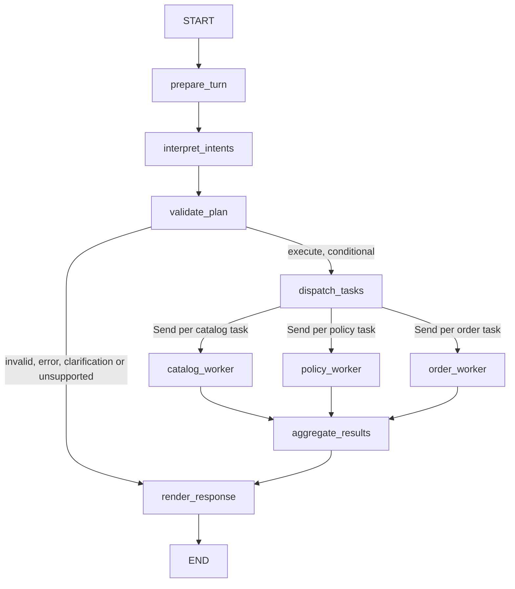

# M2 — Conversational catalog agent specification

## Cycle 1 amendment — implemented multi-intent orchestration

Current status: **Cycle 1 GREEN, ready for human code review**. This amendment
supersedes the single-intent design below. Its contracts and tests were specified
before production edits; actual RED/GREEN evidence is linked at the end of this
section. No live model, history, production policy retrieval or private order
lookup is implemented.

The first GREEN is preserved in commit `03567da`, after RED `a26e46e`. Baseline
observed for this cycle: 49 passed, 13 warnings, 76 subtests passed in 1.44s.
The single-intent envelope cannot represent independent product, policy and order
questions in one turn. Cycle 1 replaces extraction with a versioned closed plan:
`{schema_version: "2", disposition: execute|clarification|unsupported, tasks: [...]}`.
Execute requires 1–4 tasks; fallback dispositions require zero. Each task has only
`id`, `intent`, `parameters`. IDs are unique bounded identifiers; positions are
assigned by Python from array order. Intents are catalog_lookup, policy_question
and order_status. Reject duplicate normalized operations as well as duplicate IDs.
Catalog parameters retain the existing contract; policy requires a bounded topic;
order accepts an optional bounded order_reference, never an identity credential.
Reject unknown keys, raw JSON duplicates, invalid types and payloads over 16 KiB.
Related availability/price questions should be represented by one catalog task;
schema validation cannot prove semantic grouping by a future LLM.

Implemented: prepare_turn → interpret_intents → validate_plan; a conditional edge sends
valid plans to dispatch_tasks and fallbacks directly to render_response. A second
conditional edge emits one Send per validated task to its Python-allowlisted worker.
All workers write fresh TaskResult lists to a list-concatenation reducer. Their
same-superstep outputs reach aggregate_results, then render_response once. No
static dispatch-to-worker edges, redundant router, ToolNode or second model call.
Permanent tests prove actual concurrency, fan-in and ordering, not just compilation.



Only the requested Send branches run. There is no static edge from dispatch_tasks
to a worker or aggregate_results. Worker-to-aggregate edges target the same node;
LangGraph's superstep barrier waits for every dispatched worker, then schedules
one aggregate invocation. A static join requiring all three worker names would
incorrectly wait for unrequested domains; it is deliberately not used. The reducer
is `Annotated[list[TaskResult], operator.add]`: concatenation returns a new list and
retains duplicate writes for detection instead of silently overwriting/deduplicating
them. The fan-in checks identities, positions, domains and cardinality, synthesizes
an aggregation_error result for a missing/duplicate/mismatched task, then sorts.
Unexpected unplanned identities invalidate all task results conservatively.
Normal domain errors preserve successful independent results as partial_failure.

Parent state owns session_id/message (caller), raw_plan (untrusted adapter output),
validated_plan/routing_outcome (application validation), task_results (worker-only
reducer), ordered_results (aggregation) and final_reply (renderer). All state is
fresh per invoke. WorkerState contains only one ValidatedTask: task_id, position,
intent enum and validated_parameters. Dependencies are bound per agent, not state
or globals. TaskResult records task_id, position, domain, status, facts,
source_references and error_category. Facts come only from domain services.
AgentReply retains status/text/products and gains ordered task outcomes.

| State field | Owner and lifecycle |
|---|---|
| session_id, message | Caller inputs; prepare validates bounds. Not sent to workers. |
| raw_plan | One adapter extraction per valid turn, untrusted; fresh None at prepare. |
| validated_plan | Validate node builds fresh task objects, assigning array positions; otherwise empty. |
| task_results | Prepare initializes empty; worker-only concatenation updates during one superstep. |
| ordered_results | Aggregate constructs checked results; empty on non-dispatch paths. |
| routing_outcome | Prepare/interpret/validate set control outcome; aggregate sets complete/partial/failure status. |
| final_reply | Render creates AgentReply; invoke returns only that object. Never reused next turn. |

Each accepted task yields one outcome: ok/no_matches, policy_unavailable,
authorization_required, or categorized error. Single tasks preserve useful statuses;
multiple tasks are ok/no_matches if all succeed, partial_failure for a mix of valid
results and failures, or failed if none succeeds. Integrity faults use
aggregation_error. Products are flattened in planned order, with product IDs
deduplicated; each task retains its own facts and source references. Catalog
references are application-generated snapshot record IDs, not external citations.
Policy references are copied exactly from a validated PolicyEvidence record.

Catalog remains fully functional through real M1 search and serialization. Policy
uses a typed injectable evidence boundary; missing service/evidence returns
policy_unavailable. Order has no private-data service: its unconditional denial
gate returns authorization_required. Session IDs/references never authenticate.
No private CSV access, real policy extraction, RAG, promotions or history.
Partial failures retain valid independent facts. Duplicate/missing worker results
become categorized aggregation failures. Renderer orders by original position and
never asks the model to rewrite trusted facts. Concatenation preserves every branch
write without shared mutation; a separate fan-in validates cardinality and sorts.

Migration: retain build_agent(catalog=..., model=...) and invoke(session_id=...,
message=...). Add optional policy_service. Migrate old test extraction envelopes
and schema-specific assertions to v2; preserve price, availability, invalid-input,
empty-result and no-worker fallback assertions. No legacy extraction router.
Compared with sequential Python, Send/reducers add scheduling and state complexity;
they make bounded independent tasks and fan-in explicit and testable. Workers
remain synchronous functions executed by LangGraph's thread executor. Concurrency
is capped at four and recursion_limit is 12; no custom queue, lock or barrier is
needed in production. The injected policy service must be safe for concurrent
lookup calls; synthetic tests use a lock only to record calls. No timeout or
cancellation policy is claimed. `PolicyLookup.lookup(topic=...)` returns
PolicyEvidence(text, source_references) or None; missing/malformed evidence is
unavailable, service exceptions are sanitized policy_error results.

Local source scope inspection: original PDFs were inspected locally at PDF-stream
level without printing text or uploading data. No PDF reader/text utility is
installed; complete text extraction is NOT VERIFIED. No policy rules or private
data contracts are inferred from that limited inspection or implemented here.
The user's explicit Cycle 1 boundaries govern; original customer/order CSVs remain
unread.

Observed final verification: **50 focused multi-intent cases passed**, **22 catalog
methods and 76 subtests passed**, and **99 total tests and 76 subtests passed**,
all exit 0. Thirteen existing LangSmith deprecation warnings remain. The two
controlled completion-order tests use a test-only Barrier/Event, assert that
workers have one shared superstep, require all branch completions before fan-in,
and assert aggregate/render run once. Sequential execution cannot satisfy them.
These tests establish orchestration, not future LLM classification accuracy.

See [Cycle 1 RED](../tests/evidence/m2-multi-intent-red.md) and
[Cycle 1 GREEN](../tests/evidence/m2-multi-intent-green.md). Original RED/GREEN
evidence and commits are preserved. Current production scope is 529 lines across
five modules (net +278 lines relative to the first GREEN, with substantial reuse).
Cycle 2 remains separate: session/history lifecycle, actual policy sources, deeper
commercial rules, broader failures/timeouts and end-to-end business tests. A live
LLM/provider requires later approval. Do not start Cycle 2 or commit/publish here.

## Historical first-GREEN specification and research

The remaining sections preserve the prior single-intent design, research and
observations. Their topology/schema statements are historical, superseded by the
Cycle 1 amendment above; they are not additional active routing mechanisms.

Status: **FIRST TDD GREEN VERIFIED LOCALLY; FULL M2 INCOMPLETE**.
Research date: 2026-11-02. Authorized RED and GREEN increments installed the approved
dependency, added acceptance tests and implemented the first functional graph slice.
Earlier research/RED observations below retain their original date/scope; current
execution evidence is recorded at the end. Commits and remote writes are not authorized.
The user's M2 scope supersedes the M1-only scope in AGENTS.md for this review.

## Verified baseline

- Branch `feat/agent-m2`; HEAD `c94fb13` includes original M1 `fed77a9`.
- No tracked changes at inspection. Existing untracked planning files and source
  directories are historical material, not implementation evidence; left untouched.
  `docs/M2.md` did not exist. No supplied scripts were executed.
- Read README, AGENTS, tests/README, tests/test_catalog.py, both catalog modules,
  pyproject.toml, uv.lock and .python-version. M1 source/tests and dependency files
  match the merge. Python target is 3.14.10; runtime dependencies are currently empty.
- Existing-environment verification, without synchronization or installation:

  ```sh
  UV_CACHE_DIR=/tmp/artefact-uv-cache UV_OFFLINE=1 UV_NO_SYNC=1 UV_PYTHON_DOWNLOADS=never PYTHONDONTWRITEBYTECODE=1 PYTEST_ADDOPTS='-p no:cacheprovider' uv run --locked python -m pytest -q
  ```

  Exit 0: `22 passed, 76 subtests passed in 0.23s`. This is M1 regression evidence,
  not evidence for M2 behavior. The optional private smoke test ran locally;
  no records were printed or sent externally.

## Existing contracts to preserve

`load_catalog(products_path: Path, categories_path: Path) -> Catalog` validates
source CSV/JSON atomically and returns immutable products/categories. Failures
raise sanitized `CatalogDataError`. Do not construct source records from model data.

```python
Catalog.search(
    *, name: str | None = None, category: str | None = None,
    category_id: int | None = None, max_price: Decimal | None = None,
    specs: Mapping[str, str] | None = None, purchasable_only: bool = True,
) -> tuple[Product, ...]
```

Filters combine with AND and preserve source order. Name/category matching uses
normalized substrings; spec keys/values use normalized exact matching. Unsupported
spec keys and normalized duplicate query keys raise ValueError, even if other
filters would return nothing. Missing specs never match. Positive integer IDs
exclude booleans. Maximum price is inclusive, finite and nonnegative. Purchasable
means active AND positive stock; informational lookup can explicitly include others.

`serialize_product(product) -> dict[str, object]` emits product_id, price_brl,
name, category_id, description, stock_quantity, status, specs, created_at and
is_purchasable. Decimal money and dates become strings; specs are copied.
All values describe a snapshot, never live stock. M1 production code stays unchanged.

## Requirements and observable acceptance

| ID | Required behavior and acceptance criteria | Proposed automated evidence |
|---|---|---|
| AGT-01 | Extract one structured intent from the allowlist `search_products`, `clarification`, `unsupported`. Application code validates the intent/parameters and maps only search_products to real Catalog.search. Compare the exact extraction contract and search kwargs; the model never selects executable operations. | Routing and argument tests below use a fake model with real CSV ingestion/search and a delegating spy. |
| AGT-02 | Every displayed product ID, price, availability and attribute comes from the current invocation's validated catalog result. Decimal strings preserve exact values. No model prose, prices, products or supplied result objects reach the response. Application rendering is the enforceable boundary; prompts alone are insufficient. | Exact response/product assertions, availability matrix and fabricated-content rejection. |
| AGT-03 | A successful empty tuple produces `no_matches` and the fixed sentence: “No matching listings were found in this catalog snapshot.” No store-wide absence claim; failures produce a different status/message. | Empty-result and tool-failure tests assert separate statuses and exact templates. |
| AGT-04 | Follow-ups receive prior customer turns and application-rendered replies in the same session. Other sessions see none of that history. Use process-local memory initially; session IDs select conversations and are not credentials. | Planned follow-up, interleaved-session and fresh-agent isolation tests. Beyond first slice. |
| AGT-05 | Reject invalid arguments before search; malformed model output, unknown intents, catalog exceptions and business-rule override attempts fail closed with fixed safe responses. No raw model output, exception text, paths, credentials or tracebacks in responses. Bound calls and input sizes. | Invalid-argument cases in first slice; malformed output, model timeout/error, malformed/unknown intents, hostile text and exception-marker cases subsequently. |

Initial vertical slice: AGT-01, AGT-02, AGT-03 and AGT-05 invalid arguments.
Full AGT-04 and broader AGT-05 remain specified future M2 work, not claimed complete
by the initial slice. RAG, policies, customer authentication, private orders,
promotions and transaction execution are excluded from M2.

## ADR — explicit LangGraph StateGraph

| Concern | Plain Python tool-calling loop | High-level agent (e.g. create_agent) | Explicit StateGraph |
|---|---|---|---|
| Complexity | Smallest dependency/control-flow surface | Short setup; implicit loop/middleware | More schema, node and edge code than Python |
| State | Own dictionary/history lifecycle | Framework message conventions | Explicit typed state; session lifecycle still application-owned |
| Tools | Own allowlist and executor | Built-in routing/execution | Small application executor; no generic ToolNode needed |
| Validation | Fully application-controlled | Requires careful interception of defaults | Explicit execution and rendering boundaries |
| Testability | Straightforward dependency injection | More framework behavior to configure | Fake model plus real graph and real catalog |
| Latency/model calls | One interpretation call is sufficient | ReAct commonly calls model again after tools | Exactly one call per turn; deterministic final rendering |
| Observability | Own stage events | Framework callbacks | Named node transitions; local redacted status/timing only |
| Future RAG | Extend loop manually | Tools/middleware available | Add retrieval branch when separately authorized |
| Future human review | Implement pause/resume manually | Framework-dependent hooks | Interrupt/resume is available with suitable persistence later |

Decision: StateGraph fits the expected evolution toward explicit retrieval,
review and resumable workflows, while keeping commercial decisions in Python.
For today's single-operation slice, plain Python would be simpler. LangGraph adds
dependencies, API maintenance and graph/state complexity; it does not itself
guarantee grounding, authorization or injection resistance. LangGraph is our
architectural choice, justified by explicit state transitions, testability,
deterministic boundaries and planned future extensions; it is not an explicit
Artefact requirement. Use only its graph primitives. No multi-agent architecture,
database, deployment runtime or duplicated routing mechanism.
The [official Graph API](https://docs.langchain.com/oss/python/langgraph/graph-api)
documents state, nodes, edges and compilation; future persistence/interrupt use
requires a separate design and security review.


### Amendment — structured intent extraction and deterministic routing

Direct LLM tool calling asks the model to select a tool name and arguments; it can
be convenient when many tools or provider-native tool APIs are needed, but still
requires application-side validation and execution controls. The selected design
instead asks for a small intent object. Python owns the fixed intent-to-operation
mapping, keeping model output independent of callable names and tool protocols.
This adds an explicit intent schema and adapter contract, with less flexibility
for arbitrary operations; it makes fallback behavior and routing easier to inspect.
Both approaches need semantic evaluation. **Structured-output schema validation
does not guarantee semantic correctness of LLM interpretation**: a well-shaped
intent may still misunderstand a category, budget or customer request.

`interpret` invokes the injected structured-output adapter once with history, the
customer message and the fixed intent schema. The extracted object remains
untrusted. `validate_execute` validates its structure and parameters, then uses an
application-owned mapping: search_products → Catalog.search; clarification and
unsupported → fixed outcomes without catalog execution. It serializes only actual
catalog results. `render` maps outcomes to fixed templates and catalog fact blocks.
Straight edges suffice: each node handles its typed error outcome. There is no
second tool-calling router, generic ToolNode, tools_condition, model retry loop,
second model call or parallel execution. The three-node graph remains unchanged.

### Public interface (first slice implemented; history remains planned)

`build_agent(*, catalog: Catalog, model: StructuredIntentModel) -> CatalogAgent`
constructs the compiled graph with instance-bound model/catalog dependencies.
There is no session store in the first GREEN slice.
`CatalogAgent.invoke(*, session_id: str, message: str) -> AgentReply` invokes the
actual graph. No public raw-state invocation. `StructuredIntentModel.extract(*,
history, message, schema) -> object` is a small protocol implemented by a fake in
tests and a provider adapter later. Raw provider messages are normalized by the
adapter but revalidated by application code. No BaseChatModel inheritance required.
The adapter must preserve raw structured JSON for duplicate-key checking before
decoding, or perform equivalent duplicate rejection itself; silently collapsing
duplicate keys before application validation violates the extraction contract.

`AgentReply` contains `status`, `text`, and JSON-safe `products`; allowed statuses
are `ok`, `no_matches`, `clarification`, `unsupported`, `invalid_request`,
`model_error`, `tool_error` (the last denotes catalog execution failure).
The renderer alone constructs text/products; callers cannot request arbitrary
model text or inject graph state. State contains history, raw intent, outcome
and trusted results, with trusted fields assigned only by application nodes.

For future AGT-04, use a per-agent dictionary of session histories, copied into each invocation;
append only customer input and application responses. Rebuild transient intent
and result fields every turn to prevent stale-result reuse. Serialize calls per
session in the initial synchronous interface. Process restart loses history.
Bound history to 20 turns and messages to 4,000 characters; return a fixed error
for oversized input. Session creation/selection belongs to the local caller,
not a model argument; this interface is not suitable as an unauthenticated public
multi-user service. No checkpointer/cache is required for this initial memory model.

### Validation and trust boundaries

Customer text and all model output are untrusted. The adapter requests the following
closed discriminated union (design notation, not production code):

```text
SearchIntent = {"intent": "search_products", "parameters": SearchParameters}
ClarificationIntent = {"intent": "clarification", "parameters": {}}
UnsupportedIntent = {"intent": "unsupported", "parameters": {}}
Intent = SearchIntent | ClarificationIntent | UnsupportedIntent
SearchParameters = {
  name?: string | null, category?: string | null,
  category_id?: integer | null, max_price?: string | null,
  specs?: object<string, string> | null, purchasable_only?: boolean
}
```

Both envelope keys are required and no other keys are allowed at any level except
catalog spec keys inside specs. Exactly one object is accepted, never an array,
multiple intents, free text or a tool-call envelope. No rationale, response prose,
confidence, operation/function name, result or commercial-fact fields are accepted.
The enum values are exact and case-sensitive. Missing intent/parameters, unknown
intent values or malformed structures produce invalid_request, no search and a
fixed safe error. Valid unsupported is distinct from an invalid enum value.

For ambiguous product requests, the extraction contract calls for clarification,
not an unconstrained search. Valid clarification produces status clarification,
empty products and exactly “Please clarify the product or search criteria you
want.” Valid unsupported produces status unsupported, empty products and exactly
“This assistant currently supports catalog product searches only.” Neither branch
executes the catalog, calls the model again or displays model-authored prose.
A malformed extraction is never silently converted to a broad search. Explicit
requests to browse all purchasable products may use search_products with {}.
The model can still misclassify ambiguity; schema validation alone cannot detect
that semantic error. Curated synthetic live-model evaluations are needed later.

SearchParameters uses a JSON object with unknown fields forbidden. Parse raw JSON with
duplicate-key rejection, including normalized spec-key collisions; reject
non-object JSON, nonfinite numbers and oversized payloads (16 KiB). Names/category
and spec keys/values must be nonblank strings (maximum 200 characters, 20 specs).
IDs must be positive exact integers, booleans excluded. `purchasable_only` must be
an exact boolean, default true; false permits informational results only and does
not alter availability. `max_price` must be a decimal string matching
`[0-9]+(?:\.[0-9]{1,2})?`, maximum 20 characters, converted with Decimal directly;
reject floats, numeric JSON values, signs, exponents, NaN and Infinity. Never round.
Null/omitted nullable fields map to None; omitted purchasable_only maps to True
and explicit null for that boolean is rejected. Catalog.search remains the final domain
validator, including supported spec keys; map its ValueError to `invalid_request`.

Only application code supplies catalog/model/session dependencies and graph
control. Intent parameters cannot name files, select sessions, change stock/status,
set prices or overwrite trusted results. Tool exceptions become `tool_error`,
never `no_matches`; model exceptions become `model_error`. Error messages are fixed.

Render product blocks using serialize_product results from real returned Product
objects. Preserve identity, monetary strings and attributes exactly; label all
availability as snapshot availability. Missing specs stay missing. Display source
strings as quoted/escaped data, never executable markup or instructions. Do not
send catalog descriptions/results back to the model. Omit free-form descriptions
from the first customer template; return only explicitly labeled attributes.
The customer boundary validates the reply structure and fails closed if trusted
result construction fails. Deterministic rendering prevents invented commercial
facts but does not prove correct LLM interpretation of every natural-language query.
No private data is sent to external services; eventual live demos must use
synthetic catalog fixtures and require a reviewed provider adapter.

## Dependency and security assessment

Public PyPI JSON metadata and official pages were read; no distributions downloaded,
no resolver run, no packages installed. Versions below are observed stable latest
versions on the research date, not an audited resolved environment. LangGraph
1.2.19 is independently confirmed by [PyPI](https://pypi.org/project/langgraph/1.2.19/)
and [GitHub releases](https://github.com/langchain-ai/langgraph/releases).
Its PyPI maintainer is `langchain`; source links identify langchain-ai/langgraph.
PyPI reports Trusted Publishing but no release provenance attestations; publisher
identity is not a code-security guarantee. Metadata bounds permitting Python 3.14
are weaker evidence than successful installation/import/tests, still NOT VERIFIED.

| Package | Candidate version | Purpose | Python compatibility | Security findings | Recommendation | Verification source |
|---|---|---|---|---|---|---|
| langgraph | 1.2.19 | StateGraph orchestration | >=3.10; pure Python wheel; classifiers stop at 3.13; 3.14 execution NOT VERIFIED | Historical deserialization and streaming advisories below | Only proposed direct runtime dependency | [PyPI JSON](https://pypi.org/pypi/langgraph/json), [release](https://github.com/langchain-ai/langgraph/releases) |
| langgraph-checkpoint | 4.3.1 | Required transitive graph primitives | >=3.10; runtime NOT VERIFIED | JSON fix 4.1.1; cache fix 4.0.0 | Accept transitively; no persisted checkpoints/cache | [metadata/source](https://pypi.org/pypi/langgraph-checkpoint/json) |
| langgraph-prebuilt | 1.1.1 | Required transitive package | >=3.10; runtime NOT VERIFIED | No separate package-specific advisory identified in reviewed LangGraph index; not a clean bill of health | No direct dependency or prebuilt agent use | [metadata/source](https://pypi.org/pypi/langgraph-prebuilt/json) |
| langgraph-sdk | 0.4.11 | Required transitive SDK | >=3.10; runtime NOT VERIFIED | URL-path fix 0.3.15; other SDK/auth advisories require final audit | Do not use remote SDK; accept transitive footprint conditionally | [metadata/source](https://pypi.org/pypi/langgraph-sdk/json) |
| langchain-core | 1.7.4 | Required transitive core | >=3.10,<4; runtime NOT VERIFIED | Deserialization fix 1.3.3; other template/serialization advisories exist | No direct import planned; do not use load/dumps of untrusted objects | [metadata/source](https://pypi.org/pypi/langchain-core/json), [advisories](https://github.com/langchain-ai/langchain/security/advisories) |
| pydantic | 2.14.2 | Required transitive validation library | >=3.10; V2 supports 3.14 from 2.12; V1 does not | Recent validation bypass fixes in 2.14.2; DoS fixes in 2.14.0 | Prefer this patched candidate transitively; use standard-library application validation initially | [metadata/source](https://pypi.org/pypi/pydantic/json), [3.14 support](https://pypi.org/project/pydantic/), [advisories](https://github.com/pydantic/pydantic/security/advisories) |
| xxhash | 4.0.2 | Required transitive hashing | >=3.9; cp314 manylinux x86-64 wheel listed; execution NOT VERIFIED | No published advisory in project's reviewed index; native-code risk remains | Transitive only; not for authentication/security hashing | [metadata/source](https://pypi.org/pypi/xxhash/json), [wheel metadata](https://pypi.org/project/xxhash/), [advisories](https://github.com/ifduyue/python-xxhash/security/advisories) |
| langchain | Not selected; latest version NOT VERIFIED | High-level agent framework | Not evaluated because excluded | Wider API/security surface unnecessary here | Do not add | [official agent docs](https://docs.langchain.com/oss/python/langchain/agents) |
| Provider SDK/integration | Not selected; provider undecided | Later real-model adapter | NOT VERIFIED | Requires provider-specific review | None for deterministic first slice; required before a live conversational demo | Decision pending |

LangGraph's exact runtime requirements in metadata are langchain-core>=1.4.7,<2,
checkpoint>=4.3.0,<5, prebuilt>=1.1.0,<1.2, SDK>=0.4.6,<0.5,
pydantic>=2.7.4 and xxhash>=3.5.0. Latest candidates above fit these bounds.
This is metadata comparison, not dependency resolution.

Verified next-level requirements: checkpoint adds ormsgpack>=1.12.0 and core;
prebuilt adds core and checkpoint. SDK adds httpx>=0.25.2, core>=1.4.0,<2,
langchain-protocol>=0.0.15, orjson>=3.11.5 and websockets>=14.
Core adds certifi>=2026.10.19, httpx>=0.23, jsonpatch>=1.33,
langchain-protocol>=0.0.20, langsmith>=0.14.9,<1, packaging>=23.2,
pydantic>=2.7.4,<3, pyyaml>=5.3, tenacity>=8.1 excluding 8.4.0,
typing-extensions>=4.7 and uuid-utils>=0.12.
Pydantic adds pydantic-core==2.50.2, annotated-types>=0.6,
typing-extensions>=4.16 and typing-inspection>=0.4.4; optional email/timezone extras
are unnecessary. xxhash declares no runtime dependencies.
These facts come from the respective linked JSON `requires_dist` fields.

Notable residual surface: native extensions (ormsgpack, orjson, pydantic-core,
xxhash, uuid-utils), HTTP/TLS dependencies, YAML parsing and LangSmith's dependency
tree. Their full versions, wheels, Python 3.14 compatibility and advisory coverage
are NOT VERIFIED without a resolved lock review. No telemetry service/account is
needed; disable tracing and avoid credentials/callback configuration. LangSmith
and the SDK remain transitive packages even when unused. Do not claim a one-package
installation footprint. Exclude checkpoint database extras, CLI, langgraph-api,
deployment SDKs, RAG frameworks and additional telemetry integrations.

### Confirmed advisories and limits

| Advisory | Affected / patched | M2 relevance |
|---|---|---|
| [GHSA-g48c-2wqr-h844](https://github.com/langchain-ai/langgraph/security/advisories/GHSA-g48c-2wqr-h844) | langgraph <=1.0.9 / 1.0.10 | Candidate newer; avoid checkpoint deserialization of untrusted data. |
| [GHSA-mhr3-j7m5-c7c9](https://github.com/langchain-ai/langgraph/security/advisories/GHSA-mhr3-j7m5-c7c9) | checkpoint <4.0.0 / 4.0.0 | Cache pickle fallback; no cache enabled. |
| [GHSA-fjqc-hq36-qh5p](https://github.com/langchain-ai/langgraph/security/advisories/GHSA-fjqc-hq36-qh5p) | checkpoint <=4.1.0 / 4.1.1 | Candidate newer; no persisted checkpoint loading. |
| [GHSA-w39p-vh2g-g8g5](https://github.com/langchain-ai/langgraph/security/advisories/GHSA-w39p-vh2g-g8g5) | SDK <=0.3.14 / 0.3.15 | Candidate newer; remote calls unused. |
| [GHSA-3fx2-cqw9-xr3c](https://github.com/langchain-ai/langgraph/security/advisories/GHSA-3fx2-cqw9-xr3c) | Advisory labels pip langgraph >=1.2.3,<1.2.14 / 1.2.14 | Streaming identifier handling; preserve publisher's package attribution despite SDK title; candidate newer. |
| [GHSA-pjwx-r37v-7724](https://github.com/langchain-ai/langchain/security/advisories/GHSA-pjwx-r37v-7724) | core 1.x <=1.3.2 / 1.3.3; <=0.3.84 / 0.3.85 | Candidate newer; avoid untrusted object deserialization. |
| [GHSA-qpmf-fgh3-ff25](https://github.com/pydantic/pydantic/security/advisories/GHSA-qpmf-fgh3-ff25) | Pydantic >=2.13,<2.14.2 / 2.14.2 | JSON extra-key validation bypass; patched candidate; forbid extras. |
| [GHSA-3r8g-cqwr-jr29](https://github.com/pydantic/pydantic/security/advisories/GHSA-3r8g-cqwr-jr29) | Pydantic >=2,<2.14.2 / 2.14.2 | Aliased TypedDict/dataclass extra-data bypass; patched candidate. |
| [GHSA-955g-x97g-8mcp](https://github.com/pydantic/pydantic/security/advisories/GHSA-955g-x97g-8mcp), [GHSA-gj4f-r7mf-jjxh](https://github.com/pydantic/pydantic/security/advisories/GHSA-gj4f-r7mf-jjxh) | Multi-host URL: 2.x <2.14; Fraction: >=2.10,<2.14 / 2.14.0 | Patched candidate; neither field type needed. |

Also reviewed the [LangGraph advisory index](https://github.com/langchain-ai/langgraph/security/advisories)
and [GitHub vulnerability database](https://github.com/advisories?query=langgraph).
Database-store namespace, CLI credential and server authorization reports reinforce
excluding those components. Other core prompt-template/serialization and SDK auth
reports, V1-only Pydantic reports and the unreviewed CVE-2026-14742 database entry
remain part of the subsequent full lock audit; this review is not exhaustive.
No advisory found does **not** mean vulnerability-free. Active releases confirm
maintenance but also API churn; pin the reviewed top-level release, lock transitives,
and test StateGraph compile/invoke and the provider adapter after approval.

### Dependency impact of the intent amendment

No dependency changes are required by this design decision: the intent enum,
closed schema description and application validation can use the standard library.
The existing langgraph==1.2.19 recommendation, transitive candidates, security
findings and NOT VERIFIED qualifications remain unchanged. No provider is selected.
A future adapter's structured-output capability and any SDK/integration dependency
must be researched and approved separately. No new dependency verification was
performed for this amendment.

## Planned TDD and actual-flow tests

The table below remains the full proposed test plan. A focused first subset is now
written and GREEN, with actual names/results in the evidence linked below; the rest
remains planned. Shared proposed invented CSV fixture:
category 1 `Test Guitars`, category 2 `Test Keys`, empty category 3 `Test Winds`;
product 101 `Aurora`, nylon, 1000.00, active/stock 3; 102 steel at 999.99;
103 nylon at 1000.01; 104 nylon active/stock 0; 105 nylon coming_soon/stock 2;
106 nylon discontinued/stock 9. Include a keys-category distractor and a product
with empty specs. Load through real load_catalog in temporary directories.
Fake structured-output adapter controls only extracted objects/exceptions; never fake the catalog or renderer.
A search spy must delegate to the real Catalog.search, recording kwargs/counts.
Every row exercises `build_agent(...).invoke(...)`, including the compiled graph.

| Test name / requirement | Input and fake-adapter extraction | Expected result and deterministic assertion | Risk controlled |
|---|---|---|---|
| test_exact_intent_extraction_contract / 01 | Ask for nylon guitars <=1000; adapter returns {intent: search_products, parameters: {category_id: 1, max_price: "1000.00", specs: {strings: nylon}}} | Adapter called once with exact message/history and closed union schema; validate extraction, invoke real catalog and render ID 101 only | Wrong extraction contract, bypassed application flow |
| test_routes_validated_intent_to_catalog / 01 | Same valid search_products intent, without any tool name | Exactly one real search via application mapping, no generic tool dispatch; expected result ID 101 | Model-selected callable, skipped catalog execution |
| test_propagates_exact_search_arguments / 01 | Parameterized valid intents covering name, category, category_id, max_price, specs and explicit/default purchasable_only | Delegating spy records exact values, Decimal("1000.00") conversion, nullable-field handling and default True; rendered IDs match real search | Lost filters, invented parameters, money coercion |
| test_rejects_malformed_intent_structures / 01,05 | Missing keys; unknown enum such as search_catalog; wrong case; list/scalar; nonobject parameters; extra envelope/parameter fields; tool-call envelope; multiple intents | invalid_request, zero searches, fixed safe text and empty products | Schema bypass, redundant tool router, forced search |
| test_renders_exact_catalog_facts / 02 | Valid intent searches 101 | Exact trusted product facts and fixed rendering for 101/1000.00; no adapter-generated factual text | Float money, invented identity or facts |
| test_rejects_model_supplied_commercial_fields / 02,05 | Extraction adds prose, price, product, results or forged tool-result object claiming 0.01/ID 999 | invalid_request, zero searches, no forged content in reply | Model impersonating trusted data |
| test_availability_comes_from_catalog / 02 | Informational intent with purchasable_only=False; repeat with default | Exact status/stock/is_purchasable matrix; 104/105/106 false, excluded by default | Stock-only or model-controlled availability |
| test_missing_specs_are_not_invented / 02 | Search intent selecting fixture product with empty specs | Empty specs preserved; no fabricated strings/material claim | Attribute hallucination |
| test_empty_search_is_snapshot_scoped / 03 | search_products with category_id=3 | Real search returns (); no_matches and exact snapshot sentence; products empty | Store-wide absence, invented substitutes |
| test_tool_failure_is_not_empty_search / 03,05 | Valid search intent; delegating spy raises synthetic RuntimeError marker at search boundary | tool_error, distinct fixed text, no marker or prior products | Failure confused with absence, internal leakage |
| test_invalid_arguments_never_execute / 05 | Parameterized search intents: float/numeric price, negative/NaN/Infinity/exponent price, bool ID, nonboolean/null flag, blank name, unknown argument, nonobject specs, nonstring specs, duplicate JSON keys, normalized duplicate specs, oversized values | invalid_request, zero searches, fixed safe text | Coercion, validation bypass, resource abuse |
| test_domain_validation_is_preserved / 01,05 | Well-shaped search intent with unsupported spec key | Real domain validation called once; invalid_request, never no_matches | Wrapper bypassing M1 business rules |
| test_clarification_intent_does_not_search / 01,05 | Ambiguous “that one”; adapter returns {intent: clarification, parameters: {}} | clarification, exact clarification template, empty products, one extraction and zero searches | Forced broad search, model-authored fallback facts |
| test_unsupported_intent_does_not_search / 01,05 | Out-of-scope policy request; adapter returns {intent: unsupported, parameters: {}} | unsupported, exact scope template, empty products, one extraction and zero searches | Unsupported operation execution |
| test_fallback_intents_reject_parameters / 05 | clarification/unsupported with nonempty parameters or extra prose | invalid_request, zero searches; no parameter leakage | Smuggling search/facts through fallback variants |

Future M2 tests: `test_followup_receives_same_session_history` (“only below 900”
retains the previous category/spec filter via a second fake extraction and real
search); `test_sessions_are_isolated` (interleave A/B and assert adapter history and
responses contain no cross-session marker); `test_new_agent_has_no_history`;
`test_model_error_is_sanitized`; `test_hostile_source_text_cannot_change_execution`;
`test_failure_clears_prior_results`. All table rows exercise the public agent flow,
not just fake-adapter return values. Assertions on real search/output verify the
application's handling of supplied intents; they do not prove LLM semantic accuracy.
Provider interpretation quality requires separate synthetic live-model evaluations
covering exact extraction, ambiguous requests and unsupported requests.

After explicit dependency approval and environment preparation:

1. Audit the newly resolved lock, verify Python 3.14 imports, then write first
   intent/routing/grounding/empty/fallback/invalid tests against the proposed public interface.
2. RED: run `uv run --locked python -m pytest -q tests/test_agent.py`; record actual
   behavior failures. Do not manufacture RED through missing packages/imports.
3. GREEN: implement the smallest graph, validator and deterministic renderer using
   the real M1 catalog; pass the new tests.
4. REFACTOR: remove duplication while retaining trust boundaries; run
   `uv run --locked python -m pytest -q` for M1 and M2. Record actual outputs and
   remaining gaps. No assertion of historical RED without observed evidence.

## Observed dependency setup and first RED increment

The approved `uv add --python 3.14.10 'langgraph==1.2.19'` updated pyproject.toml
and uv.lock and installed 37 packages, with LangGraph as the sole new direct runtime
dependency. Python remains 3.14.10. Imports and a basic real StateGraph compile/invoke
passed. The reviewed core candidate versions resolved as researched. The current
resolved tree includes LangSmith and SDK transitives but no provider SDK was added.

`uv audit --locked --output-format json` succeeded against OSV after retrying with
approved network access: 44 audited packages, 0 reported vulnerabilities and
0 adverse statuses, exit 0. Audit is experimental; this dated database result is
not a guarantee of security. Earlier NOT VERIFIED statements describe pre-install
research: local dependency resolution, the tested imports/basic graph and audit
are now verified to this extent only. Broader native/platform/framework behavior,
source-level security and provider compatibility remain unverified.

M1 regression command after installation passed: **22 passed, 13 warnings,
76 subtests passed in 0.09s**, exit 0. LangSmith emits 13 deprecation warnings about
asyncio.iscoroutinefunction; no material local compatibility blocker was observed.

`tests/test_agent.py` was written before `app/agent/catalog_agent.py`. At the recorded
RED stage, the latter contained public interface declarations, graph wiring and
NotImplementedError node stubs only. All 27 focused agent cases collected and entered the actual compiled graph;
each fails at interpret's missing behavior, not dependencies/imports. Focused run:
**27 failed, 13 warnings in 3.77s**, exit 1. Full suite: **27 failed, 22 passed,
13 warnings, 76 subtests passed in 1.22s**, exit 1. Downstream assertions remain
unreached, so RED does not independently establish each planned boundary's behavior.

See [first RED evidence](../tests/evidence/m2-red.md) for exact commands, failures,
installed inventory, requirement mapping and security limitations. M1 production
code and tests were unchanged. No functional agent behavior, GREEN, commit, push,
PR or M3 was implemented/started in that RED increment.

## Observed first GREEN increment

The instance-bound interpret, validate_execute and render nodes now implement the
first slice. Each valid invocation extracts once with a fresh closed schema and
empty history. Application validation rejects malformed envelopes, unknown fields,
invalid types/money and duplicate normalized spec keys before routing; raw JSON
also rejects duplicate keys. Valid search intents execute real Catalog.search,
which retains final supported-spec/domain validation. Prices convert directly from
validated decimal strings to Decimal. The renderer builds AgentReply from actual
serialized catalog results or fixed fallback/error messages; invoke never returns
raw graph state. Source strings are quoted data in plain-text output; consumers
must not treat the response as executable HTML/markup.

CatalogAgent compiles bound methods for its own model/catalog. Each invoke supplies
fresh graph state with no checkpoint or retained intent/results/reply. Adapters
receive a newly constructed schema/list each time. AGT-04 is deliberately absent:
session_id does not authenticate or retain conversation history, and every model
call currently receives history=[]. Invalid public input is rejected without a
model call. Model, catalog and unexpected framework/render failures have fixed
responses without raw exception text.

Existing M2 tests and assertions are unchanged: **27 passed, 13 warnings in 1.43s**,
exit 0. Full M1+M2 suite: **49 passed, 13 warnings, 76 subtests passed in 1.35s**,
exit 0. The 13 warnings remain LangSmith's asyncio.iscoroutinefunction deprecations.
An additional one-off synthetic probe passed for interleaved instance ownership,
fresh state/schema, reply mutation isolation, sanitized model/catalog failures and
duplicate JSON rejection; it is not a new permanent regression suite.

See [GREEN evidence](../tests/evidence/m2-green.md). This establishes the first
AGT-01/02/03 and AGT-05 invalid-input/fallback slice, not full M2. AGT-04, broader
AGT-05 automated failure/adversarial coverage, timeout/cancellation behavior and
live-model semantic accuracy remain incomplete. No provider or package was added,
M1 code was unchanged, and no commit, push, PR, merge or M3 was performed.

## Review gate and unresolved decisions

Approved and installed direct dependency: **langgraph==1.2.19 only**. Resolved
versions and the first OSV audit are recorded in the evidence. No direct LangChain,
provider SDK or Pydantic dependency is
needed while application code uses its own protocol and standard-library validation.
Human review is required before extending this GREEN slice.
An actual live LLM demo additionally requires provider/model choice, adapter review,
credentials and synthetic-only data; fake-model execution is not a live AI demo.
Compatibility beyond the observed local probes, unknown dependency vulnerabilities,
provider behavior and complete AGT-04/05 coverage remain unresolved.
No submission timestamp was supplied; this documentation submission ends the current
authorized work. Stop for human review; do not extend implementation or begin M3.
